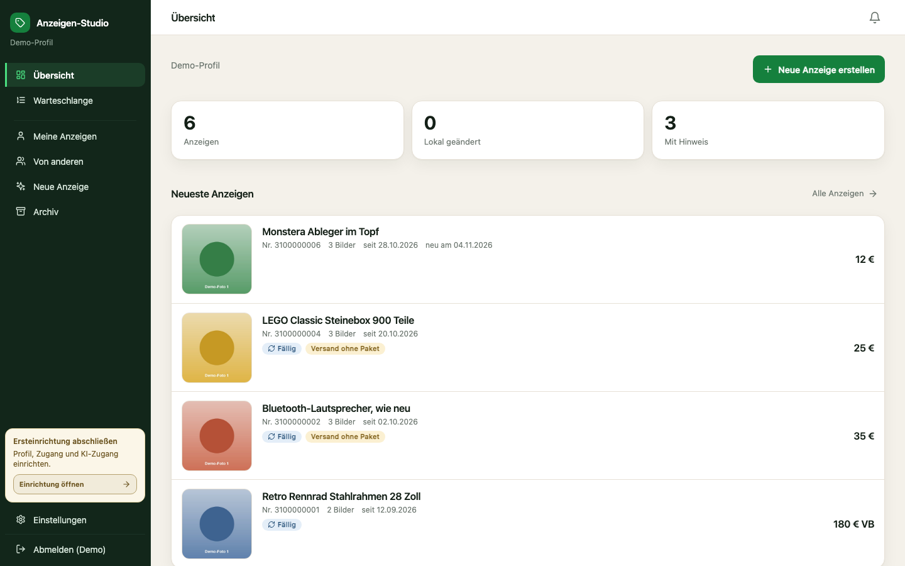
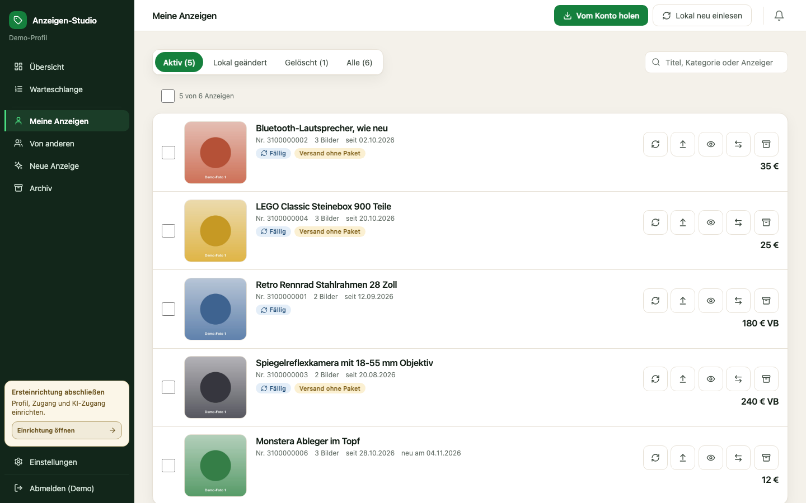
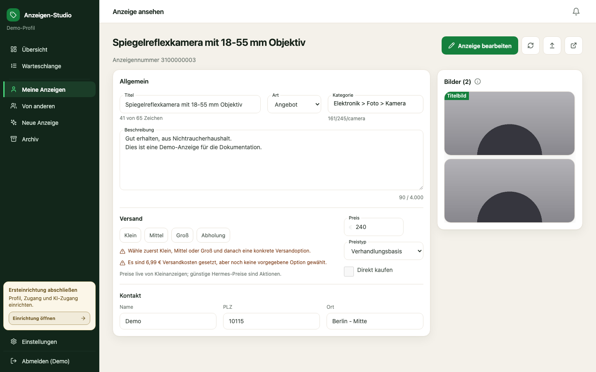
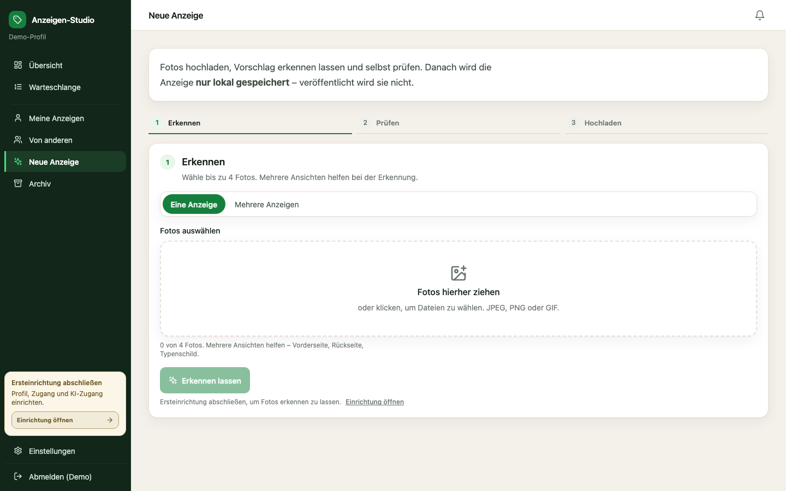
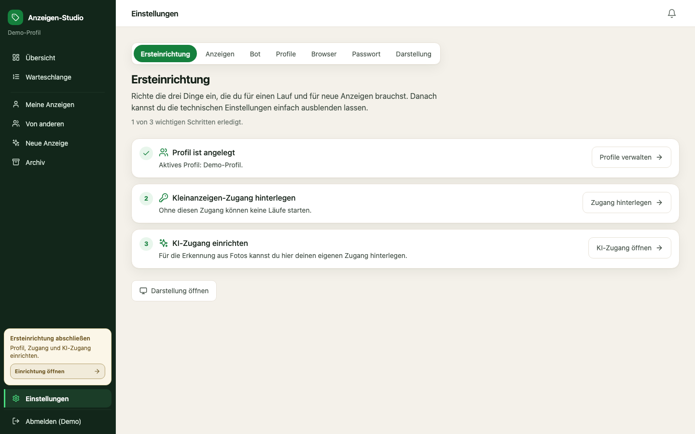
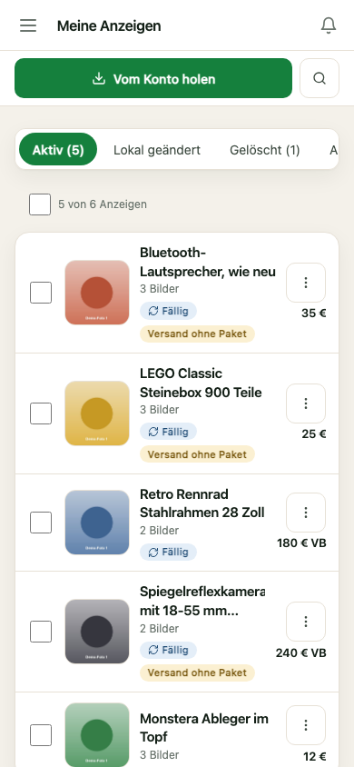

<!--
Fork-Teil, hinzugefügt 2026-08-22, ausgebaut 2026-11-03 durch die Anzeigen-Studio-Fork-Weiterentwicklung.
Der Teil ab „Upstream-Dokumentation" stammt unverändert aus dem Upstream.
SPDX-License-Identifier: AGPL-3.0-or-later
-->

# Anzeigen-Studio

[](https://github.com/TingelTangelBob/Kleinanzeigen.de-botUI/actions/workflows/anzeigen-studio.yml)
[](https://github.com/TingelTangelBob/Kleinanzeigen.de-botUI/actions/workflows/build.yml)
[](LICENSE.txt)

**Anzeigen-Studio** ist eine selbst gehostete, deutschsprachige Weboberfläche für den
[`kleinanzeigen-bot`](https://github.com/Second-Hand-Friends/kleinanzeigen-bot). Damit verwaltest du deine
Kleinanzeigen im Browser statt in YAML-Dateien und auf der Kommandozeile: Bestand vom Konto holen, Anzeigen
bearbeiten, Fotos verwalten, Läufe starten und beobachten. Aus Fotos lässt sich außerdem ein KI-Entwurf
erstellen, den du selbst prüfst.

> ## ⚠️ Dies ist ein Fork
>
> Dieses Repository ist eine **Fork-Weiterentwicklung** von
> [`Second-Hand-Friends/kleinanzeigen-bot`](https://github.com/Second-Hand-Friends/kleinanzeigen-bot)
> und wird von dessen Autoren **weder betreut noch unterstützt**.
> Fehlermeldungen zu diesem Fork gehören hierher, nicht in den Upstream-Bugtracker.
>
> Der Bot-Kern unter `src/kleinanzeigen_bot/` bleibt so unverändert wie möglich, damit Updates aus dem
> Upstream weiter übernommen werden können. Herkunft, Lizenzpflichten und die Liste der geänderten
> Upstream-Dateien stehen in [`NOTICE.md`](NOTICE.md).
>
> **Lizenz:** AGPL-3.0-or-later. Wird die Weboberfläche über ein Netzwerk auch von anderen Personen benutzt,
> greift § 13: Der Quelltext der laufenden Fassung muss diesen Personen angeboten werden.

## Inhalt

1. [Screenshots](#screenshots)
1. [Funktionen](#funktionen)
1. [Neu im Herbst 2026](#neu)
1. [Grundsätze](#grundsaetze)
1. [Installation und Start](#installation)
1. [Konfiguration](#konfiguration)
1. [Projektstruktur](#projektstruktur)
1. [Tests und CI](#tests)
1. [Weitere Dokumentation](#dokumentation)
1. [Rechtliche Hinweise und Lizenz](#rechtliches)
1. [Upstream-Dokumentation (kleinanzeigen-bot, englisch)](#upstream)

## <a name="screenshots"></a>Screenshots

Alle Screenshots zeigen eine Demo-Installation mit erfundenen Anzeigen und Platzhalterfotos. Es ist kein
echtes Konto verbunden.

| Übersicht | Meine Anzeigen |
|---|---|
|  |  |
| **Anzeige ansehen und bearbeiten** | **Neue Anzeige aus Fotos** |
|  |  |
| **Ersteinrichtung** | **Mobil** |
|  |  |

## <a name="funktionen"></a>Funktionen

### Bestand und Bearbeitung

- **Meine Anzeigen**: Liste aller eigenen Anzeigen mit Vorschaubild, Preis, Fälligkeit und Hinweisen,
  zum Beispiel „Versand ohne Paket“. Filter für *Aktiv*, *Lokal geändert*, *Gelöscht* und *Alle*, dazu eine
  Suche und Sammelaktionen für mehrere Anzeigen.
- **Von anderen**: Fremde Anzeigen lassen sich über eingefügte Links holen und als Vorlage verwenden.
- **Archiv**: Lokal archivierte und nicht mehr aktive Anzeigen, ohne dass dafür etwas am Konto passiert.
- **Anzeigeneditor**: Titel, Beschreibung, Art, Preis und Preistyp, „Direkt kaufen“ sowie die Kontaktdaten.
  Kategorie und Versandpakete wählst du aus dem echten Katalog, statt sie einzutippen.
- **Bilder**: hinzufügen, per Drag-and-drop sortieren und entfernen. Das erste Bild ist das Titelbild.
- **Versionen**: Frühere Fassungen einer Anzeige werden gespeichert und lassen sich zurücksetzen.
- **Duplizieren und Vorlagen**: Anzeigen kopieren und wiederkehrende Angaben als Vorlage speichern.
- **Schutz vor Datenverlust**: Bevor ein Download lokale Änderungen überschreiben würde, kommt eine Warnung.
  Speichern ist immer lokal, veröffentlicht wird erst beim Hochladen.

### Konto und Läufe

- **Vom Konto holen**: Lädt den Bestand des Kleinanzeigen-Kontos herunter. Fehlerhafte Einzelanzeigen werden
  übersprungen, statt den ganzen Lauf abzubrechen.
- **Hochladen**: Der Dialog zeigt vor dem Lauf, was sich ändert. Eine vorhandene Anzeige lässt sich bewusst
  neu einstellen.
- **Online löschen** sowie automatisches, kostenloses **Verlängern** fälliger Anzeigen.
- **Täglicher Abgleich** mit dem Konto: Reihenfolge wie auf der Plattform; was dort fehlt, wird lokal entfernt.
  Meldungen erscheinen in der Glocke.
- **Warteschlange**: Bot-Läufe laufen je Profil nacheinander, mit Live-Protokoll, Wartezeit-Anzeige,
  Laufbestätigung vor dem Start und Abbruch.
- **Browsersicht**: Bei Captcha oder Zwei-Faktor-Abfrage hält der Lauf an, und du übernimmst im
  eingebetteten Browser. Das Studio umgeht keine Bot-Erkennung.
- **Mehrere Profile** mit globalem Profilumschalter. Kleinanzeigen-Zugangsdaten werden verschlüsselt
  gespeichert und erst zur Laufzeit eingespeist.

### KI-Entwürfe aus Fotos

- Aus bis zu vier Fotos entsteht ein **Anzeigenentwurf** mit Titel, Beschreibung, Kategorie- und
  Versandvorschlag aus dem echten Katalog sowie einer **Preisspanne**.
- **Stapel-Erkennung**: Mehrere Gegenstände auf einmal erkennen lassen. Die Erkennungen liegen in einer
  dauerhaften Warteschlange und laufen parallel.
- **Stil**: Entwürfe orientieren sich am Ton deiner bisherigen Anzeigen.
- **Kostengrenze** und wählbares KI-Modell (Vorgabe: `gpt-6-luna`).
- Fotos werden vor dem Versand verkleinert und von Metadaten wie GPS-Koordinaten befreit.
- Ein Entwurf wird nur **lokal** gespeichert. Veröffentlicht wird nichts ohne deine ausdrückliche Bestätigung.

### Betrieb

- **Ersteinrichtung**: Assistent für Profil, Kleinanzeigen-Zugang und KI-Zugang.
- **Sicherung**: Profilarchiv als ZIP exportieren und importieren, ohne Geheimnisse. Siehe
  [`docs/SICHERUNG.md`](docs/SICHERUNG.md).
- **Anmeldung** an der Weboberfläche, **Dunkelmodus** und ein mobiles Layout.
- **Zwei Varianten**: Open Source, bei der jeder Betreiber seinen eigenen KI-Schlüssel hinterlegt, oder
  gehostet, bei der der Schlüssel beim Betreiber bleibt.

### In Arbeit

- **eBay.de**: Machbarkeit, OAuth gegen die Sandbox, Feld-Mapping und ein Client mit lokalem Dry-Run sind
  umgesetzt. Produktionsaufrufe sind gesperrt. Siehe [`docs/EBAY-MACHBARKEIT.md`](docs/EBAY-MACHBARKEIT.md) und
  [`docs/PLATTFORMEN-VINTED-EBAY.md`](docs/PLATTFORMEN-VINTED-EBAY.md).
- **Postfach**: Eine reine Leseansicht der Kleinanzeigen-Nachrichten ist geplant. Senden oder Antworten ist
  ausdrücklich nicht vorgesehen.

## <a name="neu"></a>Neu im Herbst 2026

- KI-Modell in den Einstellungen wählbar (Vorgabe `gpt-6-luna`) und **Stapel-Erkennung** für mehrere Anzeigen.
- Laufbestätigung vor jedem Bot-Lauf, **Ersteinrichtung** und KI-Entwürfe direkt in der Oberfläche.
- Gehostete Variante, Bildgrenze pro Entwurf und eine dauerhafte Erkennungswarteschlange.
- **Versionen** einer Anzeige speichern und zurücksetzen.
- Abgleich mit dem Konto entfernt lokal, was auf dem Konto fehlt. Nicht mehr erreichbare Anzeigen erscheinen
  als Laufmeldung.
- Vorhandene Anzeigen bewusst neu einstellen, automatisches kostenloses Verlängern.
- Navigation mit „Von anderen“ und „Archiv“, überarbeitetes mobiles Layout von „Meine Anzeigen“.
- Erste eBay-Bausteine (siehe [In Arbeit](#funktionen)).

## <a name="grundsaetze"></a>Grundsätze

- **KI liefert nur Entwürfe.** Ohne Bestätigung in der Oberfläche wird nichts veröffentlicht.
- **Ein Browser pro Profil, ein Lauf zur Zeit.** Gegen dasselbe Konto laufen nie zwei Läufe parallel.
- **Keine Umgehung von Captchas** oder Bot-Erkennung. Stattdessen übernimmst du in der Browsersicht.
- **Das Postfach bleibt schreibgeschützt.** Fremde Nachrichten gehen nie an einen KI-Anbieter.
- **Geheimnisse bleiben geheim.** Passwörter stehen nie in `config.yaml`, Logs, Screenshots oder Diagnosedateien.

## <a name="installation"></a>Installation und Start

Voraussetzungen: Docker mit Docker Compose. Entwicklung und Bau laufen ebenfalls in Docker.

```bash
git clone https://github.com/TingelTangelBob/Kleinanzeigen.de-botUI.git
cd Kleinanzeigen.de-botUI

cp .env.example .env
# In .env mindestens ANZEIGEN_STUDIO_SECRET_KEY setzen, zum Beispiel mit:
openssl rand -base64 32

docker compose up -d --build
```

Danach ist die Oberfläche unter <http://127.0.0.1:8080> erreichbar. Beim ersten Aufruf legst du den Zugang zur
Weboberfläche an, danach führt dich die Ersteinrichtung durch Profil, Kleinanzeigen-Zugang und KI-Zugang.

- Die Oberfläche ist bewusst nur an `127.0.0.1` gebunden. Für einen Test im Heimnetz gibt es
  `docker/anzeigen-studio/docker-compose.lan.yml`. Für den Dauerbetrieb gehört ein Reverse Proxy mit HTTPS oder
  ein VPN davor.
- Das Backend hat keinen eigenen Port nach außen. Daten liegen im Docker-Volume `studio-data`.
- Bitte erst mit einem Testkonto ausprobieren. Die Nutzung gegen ein echtes Konto liegt in deiner Verantwortung
  (siehe [Rechtliche Hinweise](#rechtliches)).

### Entwicklung

Das Frontend (`webui/`, React, Vite, Tailwind) kann im Entwicklungsmodus gegen ein laufendes Backend arbeiten:

```bash
cd webui
npm ci
VITE_API_TARGET=http://127.0.0.1:8000 npm run dev   # Vite-Server auf Port 5173, /api wird durchgereicht
```

Das Backend (`src/anzeigen_studio/`, FastAPI) ist eine App-Fabrik:
`uvicorn anzeigen_studio.main:create_app --factory`. Die Abhängigkeiten stehen in
`docker/anzeigen-studio/requirements.txt` und `requirements-bot.txt`.

## <a name="konfiguration"></a>Konfiguration

Die Konfiguration läuft über Umgebungsvariablen in `.env`. Die Vorlage ist [`.env.example`](.env.example).
**Niemals echte Schlüssel committen.** `.env` ist per `.gitignore` ausgeschlossen.

| Variable | Vorgabe | Bedeutung |
|---|---|---|
| `ANZEIGEN_STUDIO_SECRET_KEY` | *(leer)* | Schlüssel für die Verschlüsselung der Zugangsdaten, z. B. `openssl rand -base64 32`. Ohne ihn lassen sich keine Zugangsdaten speichern. |
| `ANZEIGEN_STUDIO_GEHOSTET` | `false` | `false`: Open-Source-Variante, der KI-Schlüssel wird in der Oberfläche hinterlegt. `true`: gehostete Variante, der Schlüssel kommt nur aus `.env`. |
| `ANZEIGEN_STUDIO_OPENAI_API_KEY` | *(leer)* | Nur für die gehostete Variante: `<dein-api-schluessel>`. |
| `ANZEIGEN_STUDIO_KI_MAX_BILDER` | `4` | Höchstzahl der Fotos pro KI-Entwurf. |
| `ANZEIGEN_STUDIO_KI_MODELL` | `gpt-6-luna` | Vorgabe für das KI-Modell. Gehostet gilt immer dieser Wert. |
| `ANZEIGEN_STUDIO_KI_PARALLEL` | `4` | Gleichzeitige Fotoanalysen (1–8). |
| `ANZEIGEN_STUDIO_DEV` | `false` | Entwicklungsmodus mit ausführlicheren Fehlermeldungen. |
| `EBAY_SANDBOX_APP_ID`, `EBAY_SANDBOX_CERT_ID`, `EBAY_SANDBOX_RUNAME` | *(auskommentiert)* | Nur für die eBay-Sandbox: `<app-id>`, `<cert-id>`, `<runame>`. |

Bot-Einstellungen wie Verlängern, Abgleich und Standardwerte für Anzeigen setzt du in der Oberfläche unter
**Einstellungen**. Die vollständige Referenz der Bot-Konfiguration steht in
[`docs/CONFIGURATION.md`](docs/CONFIGURATION.md) und [`docs/AD_CONFIGURATION.md`](docs/AD_CONFIGURATION.md).

## <a name="projektstruktur"></a>Projektstruktur

```text
.
├── src/
│   ├── kleinanzeigen_bot/      # Bot-Kern aus dem Upstream (möglichst unverändert, Änderungen in NOTICE.md)
│   └── anzeigen_studio/        # Backend des Studios (FastAPI)
│       ├── api/                #   REST-Endpunkte (/api/…)
│       ├── ai/                 #   KI-Entwürfe, Stil, Budget, Erkennungswarteschlange
│       ├── bestand/            #   Anzeigenbestand lesen, bearbeiten, Versionen, Abgleich
│       ├── botbridge/          #   Bot als Unterprozess, Ereignisse, config.yaml
│       ├── jobs/               #   Warteschlange, Taktung, Aufräumen
│       ├── katalog/            #   Kategorien und Versandpakete
│       ├── core/               #   Datenbank, Anmeldung, Verschlüsselung, Profile
│       └── marketplaces/ebay/  #   eBay-Anbindung (Sandbox)
├── webui/                      # Frontend (React, TypeScript, Vite, Tailwind)
├── tests/                      # Tests des Upstream-Bots
├── tests_studio/               # Tests des Studio-Backends
├── docker/anzeigen-studio/     # Dockerfiles, nginx, Compose-Zusatz für das Heimnetz
├── docs/                       # Dokumentation (Fork-Dokumente auf Deutsch)
└── docker-compose.yml          # Stack aus backend und webui
```

## <a name="tests"></a>Tests und CI

Bei jedem Push laufen **zwei** Workflows. Beide müssen grün sein:

- [`anzeigen-studio.yml`](.github/workflows/anzeigen-studio.yml) prüft den Fork: SPDX-Kennungen,
  Backend (ruff, mypy, pytest auf `tests_studio/`), Frontend (ESLint, `tsc`, Build) und den Containerbau.
- [`build.yml`](.github/workflows/build.yml) ist die Upstream-Pipeline über zehn Betriebssystem- und
  Python-Kombinationen: pip-audit, ruff, mypy, basedpyright sowie Unit-, Integrations- und Smoke-Tests.

Lokal, in Docker:

```bash
docker compose build                     # enthält ESLint, tsc, Vitest und Build des Frontends
docker compose run --rm backend pytest   # Backend-Tests
python3 scripts/check_spdx.py            # Lizenzkennungen der Fork-Dateien
```

Für den Upstream-Teil gelten die Befehle aus [`CONTRIBUTING.md`](CONTRIBUTING.md) und
[`docs/TESTING.md`](docs/TESTING.md), etwa `pdm run ruff check`, `pdm run mypy` und `pdm run ci:test:unit`.

## <a name="dokumentation"></a>Weitere Dokumentation

| Dokument | Inhalt |
|---|---|
| [`NOTICE.md`](NOTICE.md) | Herkunft, Lizenzpflichten, geänderte Upstream-Dateien |
| [`docs/SICHERUNG.md`](docs/SICHERUNG.md) | Profilarchiv und Volumensicherung |
| [`docs/RUNDLAUF.md`](docs/RUNDLAUF.md) | Herunterladen, Bearbeiten, Hochladen: was dabei verloren gehen kann |
| [`docs/ONLINE-LOESCHEN.md`](docs/ONLINE-LOESCHEN.md) | Anzeigen auf der Plattform löschen |
| [`docs/PLATTFORM-REIHENFOLGE.md`](docs/PLATTFORM-REIHENFOLGE.md) | Reihenfolge und täglicher Abgleich mit dem Konto |
| [`docs/EBAY-MACHBARKEIT.md`](docs/EBAY-MACHBARKEIT.md), [`docs/EBAY-OAUTH-SANDBOX.md`](docs/EBAY-OAUTH-SANDBOX.md), [`docs/EBAY-MAPPING.md`](docs/EBAY-MAPPING.md), [`docs/EBAY-CLIENT-DRY-RUN.md`](docs/EBAY-CLIENT-DRY-RUN.md) | eBay-Anbindung |
| [`docs/UPSTREAM-SYNC.md`](docs/UPSTREAM-SYNC.md) | Upstream-Änderungen übernehmen |
| [`docs/LIZENZEN.md`](docs/LIZENZEN.md) | Lizenzen der Abhängigkeiten |
| [`docs/RECHTLICHES.md`](docs/RECHTLICHES.md) | Rechtsrahmen und Nutzungsbedingungen |

## <a name="rechtliches"></a>Rechtliche Hinweise und Lizenz

Die Verwendung dieses Programms kann unter Umständen gegen die zum jeweiligen Zeitpunkt bei kleinanzeigen.de
geltenden Nutzungsbedingungen verstoßen. Es liegt in deiner Verantwortung, die rechtliche Zulässigkeit der Nutzung
zu prüfen. Die Nutzung erfolgt auf eigenes Risiko. Details stehen in [`docs/RECHTLICHES.md`](docs/RECHTLICHES.md).

Lizenz: [AGPL-3.0-or-later](LICENSE.txt). Neue Dateien des Forks tragen die SPDX-Kennung
`AGPL-3.0-or-later`. Upstream-Copyright: © Sebastian Thomschke und Mitwirkende.

---

# <a name="upstream"></a>Upstream-Dokumentation (kleinanzeigen-bot)

> Der folgende Text stammt unverändert aus dem Upstream und ist englisch. Er beschreibt die Kommandozeile des
> Bots, auf dem das Studio aufbaut.

---

# kleinanzeigen-bot

[](https://github.com/Second-Hand-Friends/kleinanzeigen-bot/actions/workflows/build.yml)
[](LICENSE.txt)
[](CODE_OF_CONDUCT.md)
[](https://codecov.io/github/Second-Hand-Friends/kleinanzeigen-bot)

<!--[](https://qlty.sh/gh/Second-Hand-Friends/projects/kleinanzeigen-bot)-->

**Feedback and high-quality pull requests are highly welcome!**

1. [About](#about)
1. [Installation](#installation)
1. [Usage](#usage)
1. [Configuration](#config)
   1. [Main configuration](#main-config)
   1. [Ad configuration](#ad-config)
   1. [Using an existing browser window](#existing-browser)
   1. [Browser Connection Issues](#browser-connection-issues)
1. [Development Notes](#development)
1. [Related Open-Source Projects](#related)
1. [License](#license)

## <a name="about"></a>About

**kleinanzeigen-bot** is a command-line application to **publish, update, delete, and republish listings** on kleinanzeigen.de.

### Key Features

- **Automated Publishing**: Publish new listings from YAML/JSON configuration files
- **Smart Republishing**: Automatically republish listings at configurable intervals to keep them at the top of search results
- **Bulk Management**: Update or delete multiple listings at once
- **Download Listings**: Download existing listings from your profile to local configuration files
- **Extend Listings**: Extend ads close to expiry to keep watchers/savers and preserve the monthly ad quota
- **Browser Automation**: Uses Chromium-based browsers (Chrome, Edge, Chromium) for reliable automation
- **Flexible Configuration**: Configure defaults once, override per listing as needed

### ⚠️ Legal Disclaimer

The use of this program could violate the terms of service of kleinanzeigen.de applicable at the time of use.
It is your responsibility to ensure the legal compliance of its use.
The developers assume no liability for any damages or legal consequences.
Use is at your own risk. Any unlawful use is strictly prohibited.

### ⚠️ Rechtliche Hinweise

Die Verwendung dieses Programms kann unter Umständen gegen die zum jeweiligen Zeitpunkt bei kleinanzeigen.de geltenden Nutzungsbedingungen verstoßen.
Es liegt in Ihrer Verantwortung, die rechtliche Zulässigkeit der Nutzung dieses Programms zu prüfen.
Die Entwickler übernehmen keinerlei Haftung für mögliche Schäden oder rechtliche Konsequenzen.
Die Nutzung erfolgt auf eigenes Risiko. Jede rechtswidrige Verwendung ist untersagt.

## <a name="installation"></a>Installation

### Installation using pre-compiled exe

1. The following components need to be installed:

   1. [Chromium](https://www.chromium.org/getting-involved/download-chromium), [Google Chrome](https://www.google.com/chrome/),
      or Chromium-based [Microsoft Edge](https://www.microsoft.com/edge) browser

1. Open a command/terminal window

1. Download and run the app by entering the following commands:

   1. On Windows:

      ```batch
      curl -L https://github.com/Second-Hand-Friends/kleinanzeigen-bot/releases/download/latest/kleinanzeigen-bot-windows-amd64.exe -o kleinanzeigen-bot.exe

      kleinanzeigen-bot --help
      ```

   1. On Linux/macOS:

      ```shell
      curl -L "https://github.com/Second-Hand-Friends/kleinanzeigen-bot/releases/download/latest/kleinanzeigen-bot-$(uname -s | tr '[:upper:]' '[:lower:]')-$(uname -m | sed 's/x86_64/amd64/')" -o kleinanzeigen-bot

      chmod 755 kleinanzeigen-bot

      ./kleinanzeigen-bot --help
      ```

### Installation using Docker

1. The following components need to be installed:
   1. [Docker](https://www.docker.com/)
   1. [Bash](https://www.gnu.org/software/bash/) (on Windows e.g. via [Cygwin](https://www.cygwin.com/), [MSys2](https://www.msys2.org/) or git)
   1. [X11 - X Window System](https://en.wikipedia.org/wiki/X_Window_System) display server (on Windows e.g. [Portable-X-Server](https://github.com/P-St/Portable-X-Server/releases/latest))

**Running the docker image:**

1. Ensure the X11 Server is running

1. Run the docker image:

   ```bash
   X11_DISPLAY=192.168.50.34:0.0 # replace with IP address of workstation where X11 server is running

   DATA_DIR=/var/opt/data/kleinanzeigen-bot # path to config

   # /mnt/data is the container's default working directory
   docker run --rm --interactive --tty \
     --shm-size=256m \
     -e DISPLAY=$X11_DISPLAY \
     -v $DATA_DIR:/mnt/data \
     ghcr.io/second-hand-friends/kleinanzeigen-bot:latest \
     --help
   ```

   Use `ghcr.io/second-hand-friends/kleinanzeigen-bot:preview` for the preview channel.

### Installation from source

1. The following components need to be installed:

   1. [Chromium](https://www.chromium.org/getting-involved/download-chromium), [Google Chrome](https://www.google.com/chrome/),
      or Chromium-based [Microsoft Edge](https://www.microsoft.com/edge) browser
   1. [Python](https://www.python.org/) **3.12 through 3.15**
   1. [pip](https://pypi.org/project/pip/)
   1. [git client](https://git-scm.com/downloads)

1. Open a command/terminal window

1. Clone the repo using

   ```bash
   git clone https://github.com/Second-Hand-Friends/kleinanzeigen-bot/
   ```

1. Change into the directory:

   ```bash
   cd kleinanzeigen-bot
   ```

1. Install the Python dependencies using:

   ```bash
   pip install pdm

   pdm install
   ```

   > **Pip-only side note:** `pip install .` skips PDM's nodriver patch; prefer
   > `pdm install` or run `python scripts/fix_nodriver.py` if needed.

1. Run the app:

   ```bash
   pdm run app --help
   ```

### Installation from source using Docker

1. The following components need to be installed:

   1. [Docker](https://www.docker.com/)
   1. [git client](https://git-scm.com/downloads)
   1. [Bash](https://www.gnu.org/software/bash/) (on Windows e.g. via [Cygwin](https://www.cygwin.com/), [MSys2](https://www.msys2.org/) or git)
   1. [X11 - X Window System](https://en.wikipedia.org/wiki/X_Window_System) display server (on Windows e.g. [Portable-X-Server](https://github.com/P-St/Portable-X-Server/releases/latest))

1. Clone the repo using

   ```bash
   git clone https://github.com/Second-Hand-Friends/kleinanzeigen-bot/
   ```

1. Open the cloned directory in a Bash terminal window and navigate to the [docker](docker) subdirectory

1. Execute `bash build-image.sh`

1. Ensure the image is built:

   ```text
   $ docker image ls
   REPOSITORY                            TAG      IMAGE ID       CREATED       SIZE
   second-hand-friends/kleinanzeigen-bot latest   c31fd256eeea   1 minute ago  590MB
   python                                3-slim   2052f0475488   5 days ago    123MB
   ```

**Running the docker image:**

1. Ensure the X11 Server is running

1. Run the docker image:

   ```bash
   X11_DISPLAY=192.168.50.34:0.0 # replace with IP address of workstation where X11 server is running

   DATA_DIR=/var/opt/data/kleinanzeigen-bot # path to config

   # /mnt/data is the container's default working directory
   docker run --rm --interactive --tty \
     --shm-size=256m \
     -e DISPLAY=$X11_DISPLAY \
     -v $DATA_DIR:/mnt/data \
     second-hand-friends/kleinanzeigen-bot \
     --help
   ```

## <a name="usage"></a>Usage

<!-- readme-usage:generated:start -->
```console
Usage: kleinanzeigen-bot COMMAND [OPTIONS]

Commands:
  publish  - (re-)publishes ads
  verify   - verifies the configuration files and ad integrity
  delete   - deletes ads
  update   - updates published ads
  extend   - extends ads within the 8-day window before expiry (keeps watchers/savers and does not count towards the monthly ad quota)
  download - downloads one or multiple ads
  sync-order - reads only the order of the account's own ads
  update-check - checks for available updates
  update-content-hash – recalculates each ad's content_hash based on the current ad_defaults;
                        use this after changing config.yaml/ad_defaults to avoid every ad being marked "changed" and republished
  create-config - creates a new default configuration file if one does not exist
  diagnose - diagnoses browser connection issues and shows troubleshooting information
  status   - shows ad status and APR preview details
  --
  help     - displays this help (default command)
  version  - displays the application version

Options:
  --ads=all|due|new|changed|<id(s)> (publish) - specifies which ads to (re-)publish (DEFAULT: due)
        Possible values:
        * all: (re-)publish all ads ignoring republication_interval
        * due: publish all new ads and republish ads according the republication_interval
        * new: only publish new ads (i.e. ads that have no id in the config file)
        * changed: only publish ads that have been modified since last publication
        * <id(s)>: provide one or several ads by ID to (re-)publish, like e.g. "--ads=1,2,3" ignoring republication_interval
        * Combinations: You can combine multiple selectors with commas, e.g. "--ads=changed,due" to publish both changed and due ads
  --ads=all|new|<id(s)> (download) - specifies which ads to download (DEFAULT: new)
        Possible values:
        * all: downloads all ads from your profile
        * new: downloads ads from your profile that are not locally saved yet
        * <id(s)>: provide one or several ads by ID to download, like e.g. "--ads=1,2,3"
  --ads=all|changed|<id(s)> (update) - specifies which ads to update (DEFAULT: changed)
        Possible values:
        * all: update all ads
        * changed: only update ads that have been modified since last publication
        * <id(s)>: provide one or several ads by ID to update, like e.g. "--ads=1,2,3"
  --ads=all|<id(s)> (extend) - specifies which ads to extend (DEFAULT: all)
        Possible values:
        * all: extend all ads expiring within 8 days
        * <id(s)>: specify ad IDs to extend, e.g. "--ads=1,2,3"
        * Note: ads outside the 8-day window are skipped.
  --force           - alias for '--ads=all'
  --keep-old        - don't delete old ads on republication
  --preserve-local-settings - force-enable preservation of local-only settings on re-download (overrides config value of false)
  --config=<PATH>   - path to the config YAML or JSON file (does not implicitly change workspace mode)
  --workspace-mode=portable|xdg - overrides workspace mode for this run
  --logfile=<PATH>  - path to the logfile (DEFAULT: depends on active workspace mode)
  --lang=en|de      - display language (STANDARD: system language if supported, otherwise English)
  -v, --verbose     - enables verbose output - only useful when troubleshooting issues
```
<!-- readme-usage:generated:end -->

> **Note:** The output of `kleinanzeigen-bot help` is always the most up-to-date reference for available commands and options.

Shipping inference during `download`: the bot reads the public ad shipping state. Pickup becomes `PICKUP`; `Versand möglich` without a price becomes `SHIPPING` without costs/options. Visible "shipping from" prices are kept as deprecated `shipping_costs` metadata and, when they match a current gateway option, infer one [`shipping_options`](docs/AD_CONFIGURATION.md#shipping-options-reference) entry by default. Set `download.include_all_matching_shipping_options: true` to include all non-excluded options with the same package size. `sell_directly` is resolved only for current-profile ads from cached manage-ads data.

## <a name="config"></a>Configuration

All configuration files can be in YAML or JSON format.

### Installation modes (portable vs. user directories)

On first run, the app may ask which installation mode to use. In non-interactive environments (CI/headless), it defaults to portable mode and will not prompt.

Path resolution rules:

- Runtime files are mode-dependent write locations (for example, logfile, update state, browser profile/cache, diagnostics, and downloaded ads).
- `--config` selects only the config file; it does not silently switch workspace mode.
- `--workspace-mode=portable`: runtime files are placed in the same directory as the active config file (or the current working directory if no `--config` is supplied).
- `--workspace-mode=xdg`: runtime files use OS-standard user directories.
- `--config` without `--workspace-mode`: mode is inferred from existing footprints; on ambiguity/unknown, the command fails with guidance (for example: `Could not infer workspace mode for --config ...`) and asks you to rerun with `--workspace-mode=portable` or `--workspace-mode=xdg`.

Examples:

- `kleinanzeigen-bot --config /sync/dropbox/config1.yaml verify` (no `--workspace-mode`): mode is inferred from detected footprints; if both portable and user-directories footprints are found (or none are found), the command fails and lists the found paths.
- `kleinanzeigen-bot --workspace-mode=portable --config /sync/dropbox/config1.yaml verify`: runtime files are rooted at `/sync/dropbox/` (for example `/sync/dropbox/.temp/` and `/sync/dropbox/downloaded-ads/`).
- `kleinanzeigen-bot --workspace-mode=xdg --config /sync/dropbox/config1.yaml verify`: config is read from `/sync/dropbox/config1.yaml`, while runtime files stay in user directories (on Linux: `~/.config/kleinanzeigen-bot/`, `~/.local/state/kleinanzeigen-bot/`, `~/.cache/kleinanzeigen-bot/`).

1. **Portable mode (recommended for most users, especially on Windows):**

   - Stores config, logs, downloads, and state in the current working directory
   - No admin permissions required
   - Easy backup/migration; works from USB drives

1. **User directories mode (advanced users / multi-user setups):**

   - Stores files in OS-standard locations
   - Cleaner directory structure; better separation from working directory
   - Requires proper permissions for user data directories

**OS notes (brief):**

- **Windows:** User directories mode uses AppData (Roaming/Local); portable keeps everything alongside the `.exe`.
- **Linux:** User directories mode uses `~/.config/kleinanzeigen-bot/config.yaml`, `~/.local/state/kleinanzeigen-bot/`, and `~/.cache/kleinanzeigen-bot/`; portable uses `./config.yaml`, `./.temp/`, and `./downloaded-ads/`.
- **macOS:** User directories mode uses `~/Library/Application Support/kleinanzeigen-bot/config.yaml` (config), `~/Library/Application Support/kleinanzeigen-bot/` (state/runtime), and `~/Library/Caches/kleinanzeigen-bot/` (cache/diagnostics); portable stays in the current working directory.

If you have footprints from both modes (portable + XDG), pass an explicit mode (for example `--workspace-mode=portable`) and then clean up unused files. See [Configuration: Installation Modes](docs/CONFIGURATION.md#installation-modes).

### <a name="main-config"></a>1) Main configuration ⚙️

The main configuration file (`config.yaml`) is **required** to run the bot. It contains your login credentials and controls all bot behavior.

**Quick start:**

```bash
# Generate a config file with all defaults
kleinanzeigen-bot create-config

# Or specify a custom location
kleinanzeigen-bot --config /path/to/config.yaml publish
```

**Minimal config.yaml:**

```yaml
# yaml-language-server: $schema=https://raw.githubusercontent.com/Second-Hand-Friends/kleinanzeigen-bot/main/schemas/config.schema.json
login:
  username: "your_username"
  password: "your_password"
```

To avoid storing credentials in the config file, use environment variable substitution:

```yaml
login:
  username: "${KLEINANZEIGEN_BOT_USERNAME}"
  password: "${KLEINANZEIGEN_BOT_PASSWORD}"
```

```bash
export KLEINANZEIGEN_BOT_USERNAME=your@email.com
export KLEINANZEIGEN_BOT_PASSWORD=your_password
```

Plain-text values in config.yaml are still fully supported.

📖 **[Complete Configuration Reference →](docs/CONFIGURATION.md)**

Full documentation including timeout tuning, browser settings, ad defaults, diagnostics, and all available options.

### <a name="ad-config"></a>2) Ad configuration 📝

Each ad is defined in a separate YAML/JSON file. The `publish` workflow reads files matched by the `ad_files` glob pattern. The `download` workflow writes files into `download.dir` (default: the literal `downloaded-ads/` directory in the workspace root).

In XDG mode, the bare default `downloaded-ads/` stays in the workspace default download location. If you want a config-relative shared tree, set `download.dir` to `./downloaded-ads` and point `ad_files` at that tree, for example `./downloaded-ads/**/*.yaml`.

Downloaded folder/file names are configured separately with `download.folder_name_template` and `download.ad_file_name_template`. For example: `ad_{id} {title}` or `{title} ({id})`.

When an ad is published or republished and receives a new ID, the bot updates the `id` inside the existing local ad file; it does not rename local files or folders automatically.

**Quick example (`ad_laptop.yaml`):**

```yaml
# yaml-language-server: $schema=https://raw.githubusercontent.com/Second-Hand-Friends/kleinanzeigen-bot/main/schemas/ad.schema.json
active: true
title: "Gaming Laptop - RTX 3060"
description: |
  Powerful gaming laptop in excellent condition.
  Includes original box and charger.
category: "Elektronik > Notebooks"
price: 450
price_type: NEGOTIABLE
images:
  - "laptop/*.jpg"  # Relative to ad file location (or use absolute paths); glob patterns supported
```

📖 **[Complete Ad Configuration Reference →](docs/AD_CONFIGURATION.md)**

Full documentation including automatic price reduction, shipping options, category IDs, and special attributes.

### <a name="existing-browser"></a>3) Using an existing browser window (Optional)

By default a new browser process will be launched. To reuse a manually launched browser window/process, you can enable remote debugging. This is useful for debugging or when you want to keep your browser session open.

For detailed instructions on setting up remote debugging with Chrome 136+ security requirements, see [Browser Troubleshooting - Using an Existing Browser Window](docs/BROWSER_TROUBLESHOOTING.md#using-an-existing-browser-window).

### <a name="browser-connection-issues"></a>Browser Connection Issues

If you encounter browser connection problems, the bot includes a diagnostic command to help identify issues:

**For binary users:**

```bash
kleinanzeigen-bot diagnose
```

**For source users:**

```bash
pdm run app diagnose
```

This command will check your browser setup and provide troubleshooting information. For detailed solutions to common browser connection issues, see the [Browser Connection Troubleshooting Guide](docs/BROWSER_TROUBLESHOOTING.md).

## <a name="development"></a>Development Notes

> Please read [CONTRIBUTING.md](CONTRIBUTING.md) before contributing code. Thank you!

## <a name="related"></a>Related Open-Source projects

- [DanielWTE/ebay-kleinanzeigen-api](https://github.com/DanielWTE/ebay-kleinanzeigen-api) (Python) API interface to get random listings from kleinanzeigen.de
- [f-rolf/ebaykleinanzeiger](https://github.com/f-rolf/ebaykleinanzeiger) (Python) Discord bot that watches search results
- [r-unruh/kleinanzeigen-filter](https://github.com/r-unruh/kleinanzeigen-filter) (JavaScript) Chrome extension that filters out unwanted results from searches on kleinanzeigen.de
- [simonsagstetter/Feinanzeigen](https://github.com/simonsagstetter/feinanzeigen) (JavaScript) Chrome extension that improves search on kleinanzeigen.de
- [Superschnizel/Kleinanzeigen-Telegram-Bot](https://github.com/Superschnizel/Kleinanzeigen-Telegram-Bot) (Python) Telegram bot to scrape kleinanzeigen.de
- [tillvogt/KleinanzeigenScraper](https://github.com/tillvogt/KleinanzeigenScraper) (Python) Webscraper which stores scraped info from kleinanzeigen.de in an SQL database
- [TLINDEN/Kleingebäck](https://github.com/TLINDEN/kleingebaeck) (Go) kleinanzeigen.de Backup
- [bkd3sign/kleinanzeigen-bot-ui](https://github.com/bkd3sign/kleinanzeigen-bot-ui) (TypeScript) A self-hosted web interface for kleinanzeigen-bot

## <a name="license"></a>License

All files in this repository are released under the [GNU Affero General Public License v3.0 or later](LICENSE.txt).

Individual files contain the following tag instead of the full license text:

```text
SPDX-License-Identifier: AGPL-3.0-or-later
```

This enables machine processing of license information based on the SPDX License Identifiers that are available here: <https://spdx.org/licenses/>.
